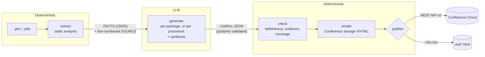
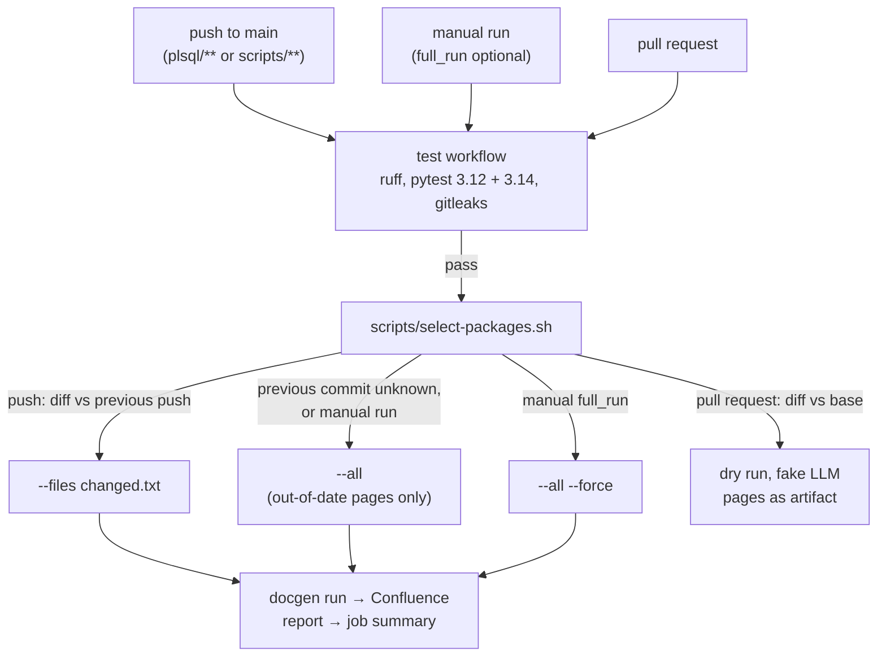

# Design

This document explains how the generator is built, why, what was considered
instead, and what would change for production use. Measured results are in
[RESULTS.md](RESULTS.md); setup and usage are in the [README](../README.md).

## Goal and principles

The goal is documentation of legacy PL/SQL that a functional analyst can trust
enough to use. Three principles follow from that and drive most decisions below.

1. **Grounded.** Everything the model claims must be traceable to the code. What
   can be determined without a model (signatures, tables, calls, raised errors) is
   computed deterministically and shown as authoritative. The model only adds
   what needs understanding (purpose, business rules, flow, edge cases), and
   every business rule cites the lines that implement it.
2. **In sync.** A page is regenerated when, and only when, something that
   produced it changed: the code, the prompts, the model or the renderer.
3. **Honest about uncertainty.** The model is told to turn anything ambiguous
   into an open question instead of guessing, and the page states which parts are
   AI-generated and which automated checks failed.

The LLM is treated as an untrusted component: its output is constrained by a
schema, validated, checked against the code and rendered by our own code.

## Architecture

| Stage | Module | Input | Output |
|---|---|---|---|
| extract | `docgen.extract` | spec + body files | `PackageFacts`: subprograms, parameters, visibility, tables and SQL operations per line, calls to other packages, sequences, raised errors, globals, warnings |
| generate | `docgen.generate` | FACTS + numbered SOURCE + prompts | `UnitDoc`, validated |
| check | `docgen.checks` | FACTS, SOURCE, `UnitDoc` | cleaned `UnitDoc` + findings |
| render | `docgen.render` | FACTS, `UnitDoc`, findings, page metadata | storage-format XHTML |
| publish | `docgen.publish` | title, body, labels, cache key | created / updated / skipped |

Packages are processed one at a time (free-tier rate limits) and in isolation:
a failure in one package is reported and the run continues with the next.

### Extract: static analysis first

The extractor is a purpose-built scanner, not a full PL/SQL grammar. It masks
comments and string literals (keeping every offset and newline, so line numbers
stay exact), tokenises, and recognises only the structures documentation needs:
package and subprogram headers, parameter lists, block boundaries, SQL
statements and their tables, `pkg.member` calls, `RAISE_APPLICATION_ERROR`.
Because matching runs on masked text, SQL inside comments or dynamic SQL strings
is never mistaken for real table access; dynamic SQL is flagged instead.

It also emits warnings a reviewer needs: private subprograms that are never
called, spec declarations without a body, dynamic SQL, initialisation sections,
and truncated source. These go on the page as open questions "from static
analysis", separate from the model's.

FACTS are authoritative: they are rendered directly (interface, data touched,
dependencies, raised errors) and the model is told not to restate or contradict
them, only to use them.

### Generate: constrained, validated, cited

The model receives FACTS as JSON and the body as SOURCE with every line
prefixed by its line number, and must answer with JSON that matches the
`UnitDoc` schema:

| Field | Content |
|---|---|
| `source_complete` | false if SOURCE looks truncated |
| `purpose` | what the package is for |
| `procedure_notes` | one summary per subprogram |
| `business_rules` | `rule`, `implemented_in` (procedure), `evidence_lines` [first, last], `confidence` |
| `main_flow` | ordered steps, each linked to a procedure |
| `edge_cases` | behaviour on unusual inputs visible in the code |
| `open_questions` | everything ambiguous or suspicious, as questions for a reviewer |

The schema is passed as the provider's structured-output schema (Gemini
`response_json_schema`, OpenRouter `response_format: json_schema` with
`strict: true`), and the answer is still validated with pydantic, because
providers do not enforce every constraint. A validation failure gets one retry
with the errors appended; a second failure fails the package.

The system prompt (`src/docgen/prompts/system.md`, 17 rules) encodes the
grounding policy: describe only what is visible in SOURCE; cite the narrowest
line range inside the named procedure; quote identifiers exactly; commented-out
code is never a rule; give a business reason only when a code comment states
it; never expand or guess abbreviations and codes, ask instead; and list dead
code, unreachable branches, magic numbers, swallowed exceptions, commented-out
logic and cryptic names as open questions.

**Large packages.** A body longer than `CHUNK_THRESHOLD_LINES` (150) is
documented per subprogram: each call sees the package-level declarations plus
that one subprogram, with the original line numbers, so evidence stays valid. A
synthesis call then merges the per-subprogram documents into one, without seeing
SOURCE again. This keeps each prompt small and focused, at the cost of more
calls and of information that can be lost in the merge (see the T3 result in
RESULTS.md).

**Cache.** Validated answers are cached on disk, keyed by a hash of the complete
request (model, prompts, FACTS, SOURCE, schema). Re-running after a failure, or
re-rendering after a renderer change, costs no model calls.

### Check: deterministic verification

| Check | What it verifies | On failure |
|---|---|---|
| faithfulness | every identifier-like token in the model's text (names with `_` or `.`, ALL-CAPS words) exists in SOURCE (comments included) or FACTS | flagged |
| faithfulness | procedure names the model links to are real subprograms | rule or note dropped; a flow step keeps its text, loses the link, and is flagged |
| evidence | a rule's line range lies inside the body and inside the procedure it names | dropped |
| coverage | every subprogram has a note; every table from FACTS appears on the rendered page | flagged |

Policy: an item that cannot be rendered truthfully (a rule pointing at a
procedure that does not exist or at lines outside it) is dropped; anything else
is kept and flagged. Every finding is listed on the page under "Automated
checks" and in the run report, so a reviewer sees exactly what was doubted.

The identifier check allows Oracle built-ins (`NO_DATA_FOUND`, `SQLERRM`, ...)
and SQL/PL/SQL keywords (`COMMIT`, `GROUP`, ...). Both lists were added after
eval runs showed them as false positives; reserved words cannot be object names,
so allowing them hides no invented identifier. Saved runs are re-scored with
`docgen.eval rescore`, which keeps the original numbers next to the new ones.

### Render: the model never writes markup

The renderer builds Confluence storage format from FACTS and the validated
`UnitDoc`. All model text is escaped. The model never produces HTML or
Confluence macros, so it cannot break the page, inject markup or links, or
hallucinate formatting. Rendering is deterministic: the same inputs give
byte-identical output (the timestamp is an input).

Each page opens with a "DRAFT, AI-generated, needs functional review" banner
and a panel with the commit, model, prompt version and generation time. Each
section says where it comes from: "static analysis" or "AI-generated".
Evidence lines link to the source at that commit on GitHub when
`SOURCE_BASE_URL` is set. Pages carry the label `ai-generated`.

### Publish: idempotent REST

`docgen.publish.rest` uses the Confluence Cloud REST API v2 (v1 only for
labels, which v2 cannot write). Pages are found by title (unique within a space)
under the configured parent, then created or updated with
`version.number = current + 1`. The cache key is stored in a page property and
written *after* the body: if a run fails in between, the next run sees an
outdated key and regenerates, instead of treating a half-written page as current.

## Keeping pages in sync

**What is out of date.** Every page stores
`sha256(source hash, prompt fingerprint, model, renderer version, chunk threshold)`.
A run compares it with the key it would produce and skips matching pages
without calling the model. The prompt fingerprint is a hash of the prompt files,
so an edited prompt invalidates pages even if nobody bumps `VERSION`.

**When to run.** CI decides which packages to look at; the cache key decides
which of those to regenerate.

- **Push to main** diffs against `github.event.before`. If that commit is not in
  the history (first push, force push), it falls back to every out-of-date page,
  which is safe because unchanged pages are skipped.
- **Prompt or model changes** are not triggers. They make every page out of
  date, so they should go through the eval first; a manual run then regenerates
  exactly the stale pages. This is a deliberate release step, not an oversight.
- **Pull requests** get a dry run with the fake LLM: no secrets (safe for forks),
  no quota, and the rendered pages as an artifact to review the layout.
- Publishing **needs the tests to pass** (`test.yml` is called as a reusable
  workflow), runs **one at a time** (a newer push queues instead of cancelling a
  half-finished publish), and **keeps the LLM answer cache** between runs, so a
  re-run after a quota failure only pays for what failed.
- Deleted packages are reported, but their pages are left in place.

## LLM providers and reliability

Generation goes through one small interface, `LLMClient.generate_json(system,
user, response_model)`, with three implementations: Gemini (google-genai SDK),
OpenRouter (plain httpx against its OpenAI-compatible API) and a fake that
returns deterministic, schema-valid answers for offline tests and CI dry runs.
The provider and model are configuration, not code.

Free tiers shaped the error handling more than anything else (details in
RESULTS.md):

- **Retries are ours**, with exponential backoff and full jitter, honouring the
  server's retry delay.
- **Errors are classified per provider** into: rate limit (wait and retry),
  overloaded (503: few, long waits, because every rejected request still counts
  against Gemini's daily quota), transient (5xx, timeouts), daily quota exhausted
  (never retried), and permanent errors.
- **Stop early.** When the model is unavailable (overloaded after its retries,
  or out of quota), the run stops calling it and marks the remaining packages
  "not attempted", instead of burning the rest of the quota on certain failures.
- **OpenRouter specifics:** `provider.require_parameters: true` so requests only
  go to endpoints that honour the JSON schema; errors are detected inside 200
  responses and inside `choices[0].error`; a cut-off answer
  (`finish_reason=length`) is an error, not a truncated document.

## Evaluation design

The eval answers one question: does the documentation find what a careful human
reviewer would find, without making things up?

- **Seeded traps.** The fake codebase contains nine deliberate problems, each
  typical of legacy code: a hidden seasonal rule inside a CASE, a dead private
  procedure, a branch guarded by a constant `FALSE`, a cross-package call,
  a magic number, two swallowed exceptions, cryptic flag names, and a
  commented-out discount block.
- **Ground truth without line numbers.** `eval/ground_truth.yaml` locates each
  trap by package, procedure and an anchor regex that must match exactly one
  line (enforced by a test), and says in which `UnitDoc` field it must be
  reported and which regexes must all match. Hallucination is scored separately:
  the commented-out discount must not appear as a business rule.
- **Deterministic scoring.** No LLM-as-judge: scoring is regexes and line
  arithmetic, so it is reproducible and cheap, and its mistakes are visible
  and fixable (two calibrations so far, both recorded).
- **Results are data.** Each run is a JSON file in `eval/results/` with the
  model, prompt fingerprint, settings, commit, every model answer and every
  call's tokens and latency. `rescore` re-applies newer checks to stored answers
  without calling the model; `--resume` finishes a run cut short by a quota.
- **The eval uses the production path**: the same extract, generate, check and
  render code, so it measures what would be published.

## Security

- Secrets are `SecretStr`, read only where they are sent, and never part of an
  error message, log line, report or test fixture. pydantic's validation
  messages (which echo input values) are rebuilt from field names only.
- `.env` is gitignored; gitleaks runs before each commit and over the full
  history in CI; workflows reference secrets only as `${{ secrets.* }}` and pass
  them only to the publishing step; permissions are `contents: read`; actions are
  pinned to commit SHAs.
- Pull requests never receive secrets: their docs job uses the fake LLM.
- Model output is untrusted: schema-validated, escaped on render, never
  interpreted as markup.

## Alternatives considered

| Decision | Chosen | Alternatives | Why |
|---|---|---|---|
| Who writes the page markup | Deterministic renderer from validated JSON | LLM writes Confluence XHTML or Markdown directly | Structure guaranteed; no injection or broken markup; output checkable field by field; layout changes without regenerating |
| Static analysis | Purpose-built scanner on masked tokens | ANTLR PL/SQL grammar; Oracle data dictionary (`ALL_DEPENDENCIES`, `ALL_IDENTIFIERS` via PL/Scope) | No database needed in CI, small and testable, exact line numbers. ANTLR is heavy for the few structures needed; the data dictionary is the most accurate but needs a live database with the code compiled |
| Grounding | Line-numbered SOURCE + cited `evidence_lines` + checks | Free-text summaries; retrieval (RAG) over the codebase | Citations make every rule verifiable by a reviewer and by code. Packages fit in the context window, so retrieval adds complexity without benefit at this size |
| Large packages | Per-subprogram calls + synthesis | Always whole package; summarise-then-merge without line numbers | Smaller, focused prompts with valid line numbers; the cost (cross-procedure facts lost in synthesis) is measured |
| Judging quality | Seeded traps + deterministic scoring | LLM-as-judge; manual review only | Reproducible, free, and its errors are inspectable |
| Publishing | Confluence REST API v2 | Atlassian MCP server (`PUBLISH_MODE=mcp`, reserved) | REST is deterministic and easy to test with mocked HTTP, and was proven live. MCP adds a moving part (a tool-calling server whose tool names must be discovered at runtime) without new capability for a batch job. It is the natural option when an agent, not a pipeline, edits pages |
| Change detection | Git diff in CI + cache key on each page | Regenerate everything on every push; timestamps | Only pays for what changed; the key also catches prompt and model changes |
| Second LLM provider | OpenRouter | Mistral (free plan has no API access), Cohere (trial key, not for production use), Ollama (local; no GPU in CI) | Free models with structured output, OpenAI-compatible API |

## Limitations

- **The extractor is not a parser.** It handles the constructs in this codebase
  and common PL/SQL, but not everything: overloaded subprograms (same name,
  different parameters) are not told apart, and conditional compilation, object
  types and triggers are not modelled. Dynamic SQL is flagged, not analysed. Calls are recognised only in
  `pkg.member` form; standalone procedures and synonyms are not resolved.
- **The faithfulness check is lexical.** It catches invented names, not wrong
  statements made with real names ("X is called after Y" when it is not). The
  evidence check verifies that cited lines are in the right procedure, not that
  they prove the rule. Both lists of allowed words are hand-maintained.
- **Small eval.** Four packages and nine traps show whether the approach works
  and catch regressions; they are not a statistically meaningful benchmark. Each
  configuration was run once, and LLM output varies between runs.
- **Some traps are partly found by static analysis.** The dead private procedure
  is also reported by the extractor, and the model sees that warning in FACTS.
- **Synthesis can lose information.** The per-procedure documents of a large
  package are merged by a call that does not see the source; a cross-package
  call found per procedure was dropped in the merge (RESULTS.md, T3).
- **Free tiers are not dependable.** Daily quotas (Gemini: 20 requests a day for
  this model), overload storms and endpoints that disappear make complete runs
  slow and sometimes impossible on a given day.
- **Deleted packages** leave their pages in place; nothing archives them.
- **Pages are overwritten.** Manual edits on a generated page are lost at the
  next regeneration (the page history keeps them).
- **Only direct dependencies are pinned**; transitive dependencies are not
  locked.
- `PUBLISH_MODE=mcp` is reserved but not implemented.

## Path to production

- **Model and data protection.** Real code must not go to a free tier. Use a
  paid API with a no-training, no-retention agreement, or run a model on own
  infrastructure (e.g. Ollama or vLLM; Ollama supports JSON-schema output, but
  its default context window is small and silently truncates input, so it must
  be set explicitly). The `LLMClient` interface makes this a new class plus
  configuration.
- **Credentials.** A dedicated service account with a scoped Atlassian API token
  (write access to one space only) instead of a personal classic token; secrets
  in a GitHub environment with required reviewers for the publishing job.
- **Static analysis.** Use the Oracle data dictionary (PL/Scope, `ALL_DEPENDENCIES`)
  from a schema build, or a full grammar, to cover the whole language and
  resolve dependencies across schemas.
- **Dependency map.** FACTS already list calls between packages; a generated
  overview page (which package calls which, which tables are shared) is cheap to
  add and valuable for impact analysis.
- **Review workflow.** Route new and changed pages through a review state (a
  label or a draft), and let reviewers answer open questions in a way the next
  run can use as input.
- **Scale.** Parallelise packages within the provider's rate limits, and
  regenerate dependants when a package they call changes its interface.
- **Eval.** Grow the ground truth from real review findings, run the eval on
  every prompt or model change in CI, and repeat runs to measure variance.
- **Supply chain.** Lock transitive dependencies (e.g. a hashed lock file) and
  keep actions pinned with automated updates.
